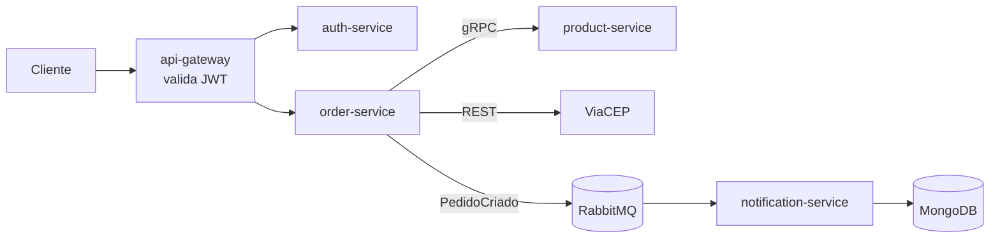

# order-platform

Sistema de pedidos construído como microsserviços em **Java 21**. Projeto de portfólio para estudar e demonstrar integração entre serviços: REST, gRPC, mensageria e autenticação com JWT.

## Arquitetura



- **REST:** borda do sistema e API externa
- **gRPC:** comunicação interna síncrona (estoque)
- **RabbitMQ:** fluxo assíncrono (evento `PedidoCriado`)
- Cada serviço tem o seu próprio banco (database per service)

## Serviços

| Serviço | Stack | Status |
|---|---|---|
| auth-service | Spring Boot, PostgreSQL, JWT | Concluído (v1) |
| product-service | Spring Boot, PostgreSQL, gRPC | Em andamento |
| order-service | Spring Boot, PostgreSQL, RabbitMQ | Planejado |
| notification-service | Quarkus, MongoDB, RabbitMQ | Planejado |
| api-gateway | Spring Cloud Gateway | Planejado |

## Tecnologias

Java 21, Spring Boot, Quarkus, Spring Data JPA, Flyway, gRPC, RabbitMQ, PostgreSQL, MongoDB, JWT, Docker, Docker Compose, JUnit 5, Mockito, Testcontainers, GitHub Actions.

## Estrutura do repositório

```
order-platform/
├── auth-service/
├── product-service/
├── order-service/
├── notification-service/
├── api-gateway/
├── docs/                 # arquitetura e convenções
└── docker-compose.yml    # (planejado)
```

## Como rodar

Em breve: Docker Compose único na raiz subindo todos os serviços e bancos. Por enquanto, cada serviço tem o seu README com instruções próprias.

## Convenções

Todos os serviços seguem o mesmo padrão: arquitetura em camadas, DTOs como records, erros em ProblemDetail (RFC 7807), Flyway, testes com Testcontainers e Conventional Commits.

## Roadmap

- [x] auth-service
- [ ] product-service
- [ ] order-service
- [ ] notification-service
- [ ] api-gateway
- [ ] Docker Compose único e CI por serviço
- [ ] Kubernetes (nível básico) e OAuth2

## Autor

Feito por [rodvpx](https://github.com/rodvpx).
